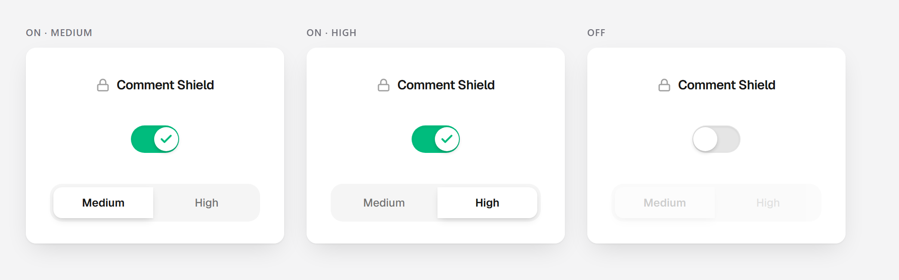

# Comment Shield

Расширение для Chrome. Замыливает грубые комментарии под видео на YouTube —
пока не нажмёшь, текста не видно.

Модель считает прямо в браузере. Комментарии никуда не уходят, сервера у
расширения нет.



## Как поставить

1. Скачать или клонировать репозиторий.
2. Открыть `chrome://extensions`, включить «Режим разработчика».
3. Нажать «Загрузить распакованное» и выбрать папку `extension`.

Собирать ничего не нужно: попап уже собран и лежит в `extension/popup`.

## Два режима

| Режим  | Порог | Когда брать |
|--------|-------|-------------|
| Medium | 0.70  | прячет только то, в чём модель уверена |
| High   | 0.50  | прячет и сомнительное, ошибается чаще |

Замыленный комментарий раскрывается по клику и обратно уже не прячется.

## Как устроено

Внутри — логистическая регрессия поверх TF-IDF: слова (1–2) и буквосочетания
(2–5). Веса лежат в `model.json`, а `classifier.js` повторяет токенизацию
scikit-learn на чистом JavaScript, без единой зависимости.

Два места, где JS расходится с Python, если делать в лоб:

- `\w` в JavaScript не знает кириллицы. Нужны свойства символов: `[\p{L}\p{N}_]`.
- `slice` режет строку по единицам UTF-16, и эмодзи разваливается пополам.
  Резать надо по кодовым точкам.

После обеих правок предсказания сошлись с Python до 5e-7.

На отложенной выборке macro-F1 — 0.81, ROC-AUC — 0.90.

## Стенд

Откройте `chrome-extension://<ID расширения>/probe.html`, впишите фразу — и
увидите вероятность и решение при обоих порогах. Удобно, чтобы показать
модель вживую.

## Если править попап

Попап написан на React с shadcn/ui и Tailwind. Исходники — в `popup-src`,
вся вёрстка в одном файле `src/App.tsx`.

```bash
cd popup-src
npm install
npm run build      # кладёт сборку в ../extension/popup
```

Иконка расширения собирается из `popup-src/icon.svg`.

## Чего здесь нет

Обучающих данных. Модель обучена на размеченном корпусе казахских
комментариев, но сам корпус в репозиторий не входит.

## Лицензия

MIT.
