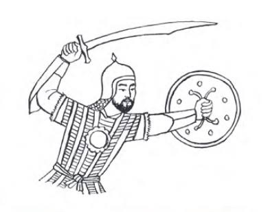

<!--p align="center">
  
</p-->

<h1 align="center">Qalqan (қалқан)</h1>

<p align="center"><strong>Щит от грубых комментариев на YouTube</strong></p>

Qalqan — расширение для Chrome, которое размывает комментарии, сочтённые
оскорбительными. Чтобы прочитать такой комментарий, нажмите на него. Название
«қалқан» по-казахски означает «щит».

Проверка выполняется локально в браузере: текст комментариев не отправляется
на сервер расширения.

## Установка

1. Скачайте или клонируйте репозиторий.
2. Откройте `chrome://extensions` и включите «Режим разработчика».
3. Нажмите «Загрузить распакованное» и выберите папку `extension`.

Попап уже собран в `extension/popup`, поэтому для установки сборка не нужна.

## Режимы

| Режим | Порог вероятности | Поведение |
|-------|-------------------|-----------|
| Medium | 0,70 | Размывает комментарии, в которых модель уверена больше |
| High | 0,50 | Размывает больше комментариев, но чаще ошибается |

Раскрытый комментарий остаётся видимым, пока YouTube не заменит его текст.
Расширение можно выключить в попапе.

## Как это работает

Внутри — логистическая регрессия поверх TF-IDF: слова (1–2) и буквосочетания
(2–5). Веса хранятся в `extension/model.json`, а `extension/classifier.js`
повторяет токенизацию scikit-learn на JavaScript без внешних зависимостей.

Для кириллицы используется Unicode-проверка букв и цифр: стандартное `\w` в
JavaScript её не охватывает. Буквосочетания режутся по кодовым точкам, чтобы не
разделять эмодзи на части. При сравнении с Python предсказания совпали с
точностью до 5e-7. На отложенной выборке macro-F1 — 0,81, ROC-AUC — 0,90.

Модель может ошибаться. Обучающий корпус казахских комментариев в репозиторий
не входит.

## Проверка модели

Откройте `chrome-extension://<ID расширения>/probe.html`, введите фразу и
посмотрите вероятность и решения при обоих порогах.

## Разработка попапа

Попап написан на React с shadcn/ui и Tailwind. Исходники находятся в
`popup-src`, основная вёрстка — в `popup-src/src/App.tsx`.

```bash
cd popup-src
npm ci
npm run build
```

Сборка попапа попадёт в `extension/popup`. Исходник логотипа —
`extension/icons/icon.png`; размеры для Chrome лежат рядом с ним.
Проверка классификатора: `node --test tests/classifier.test.mjs` из корня
репозитория.

## Лицензия

MIT.
